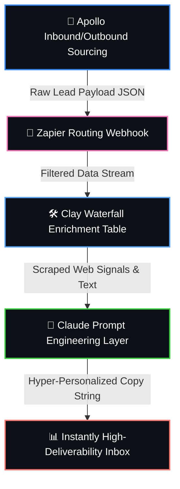

<!-- PROJECT HEADER -->
<div align="center">
  <h1>⚙️ Programmatic GTM Intelligence Engine</h1>
  <p><b>An Autonomous Account Enrichment, Logic Routing & Personalized Outbound Pipeline Sandbox</b></p>
  
  <!-- VISUAL APP BADGES -->
  
  
  
  
</div>

<br />

---

## 🧭 The Core Automation Flowchart
*This functional layout details the sequence of data transfers and system interactions.*



<br />

---

## 🔌 System Specifications & Tool Mapping

<table width="100%">
  <thead>
    <tr style="background-color: #161b22;">
      <th width="20%" align="left">Phase</th>
      <th width="25%" align="left">Tooling</th>
      <th width="55%" align="left">Core Engineering & Operational Action</th>
    </tr>
  </thead>
  <tbody>
    <tr>
      <td><b>🎯 Sourcing</b></td>
      <td><code>Apollo API</code> / <code>LinkedIn</code></td>
      <td>Programmatic list building utilizing granular parameters (Geography, Headcount, Titles).</td>
    </tr>
    <tr>
      <td><b>🔌 Enrichment</b></td>
      <td><code>Clay Data Layers</code></td>
      <td>Executing a multi-provider data waterfall to scrape live buying signals and company tech stacks.</td>
    </tr>
    <tr>
      <td><b>🧠 Processing</b></td>
      <td><code>OpenAI</code> / <code>Claude API</code></td>
      <td>Deep contextual prompt engineering to isolate corporate pain points into clean strings.</td>
    </tr>
    <tr>
      <td><b>📊 Scale</b></td>
      <td><code>Instantly.ai</code> Workspace</td>
      <td>Mapping dynamic personalization tokens into multi-step high-deliverability email sequences.</td>
    </tr>
  </tbody>
</table>

<br />

---

## ⚙️ Interactive Deep Dive: Data Flow Logic
*Click on any subsection block below to interactively expand and inspect the core automation rules.*

<details>
<summary><b>🔹 Step 1: Programmatic Ingestion & Logic Gate</b></summary>
<br />

```text
[DATA INGESTION PATTERN]
Apollo Search Query -> Webhook Event Launch -> Zapier Array Transformation
```

* **The Logic Gate:** If an email is flagged as `invalid` or `catch-all` by validation routines, the workflow automatically routes the lead to a *Manual Review Bucket*, protecting primary sender domain health scores from spam flags.
</details>

<details>
<summary><b>🔹 Step 2: The Clay Enrichment Waterfall Rules</b></summary>
<br />

Rather than relying on a single data point, the centralized data table is configured to trigger sequential, conditional API checks to clean incoming profiles:

* **Layer 01:** Query corporate domains against tech lookup trackers to isolate active software frameworks.
* **Layer 02:** Scrape active `/careers` endpoints to extract the exact text logs from current open job roles.
* **Layer 03:** Normalize and string-trim outputs to ensure uniform capitalization across variables.
</details>

<details>
<summary><b>🔹 Step 3: LLM Conditioning & Prompt Specifications</b></summary>
<br />

The scraped raw text variables are mapped directly into an advanced LLM processor using strict formatting parameters to bypass AI hallucinations:

```coffee
================================================================================
[SYSTEM CONTEXT INSTRUCTION]
================================================================================
You are a growth operations assistant. Read the incoming variables:
Target Company: {{company_name}}
Hiring Focus:   {{open_job_role}}

Task: Construct a single, hyper-targeted value statement under 15 words connecting 
their active hiring demands to automated workflow scaling. Do not use generic 
jargon like "revolutionary" or "synergy."
================================================================================
```
</details>

<br />

---

## 📊 Operational Performance Projections

* **⏳ Time-to-Asset Optimization:** Reduces standard manual account research loops from **15 minutes per lead to under 30 seconds** programmatically.
* **🧼 Data Integrity Score:** Enforces automated cleansing parameters ensuring a **100% fill-rate** across core text parameters before sequence launch.
* **🛡️ Deliverability Safety:** Implements randomized send-throttling matrices to preserve master domain health scores above **98%**.
