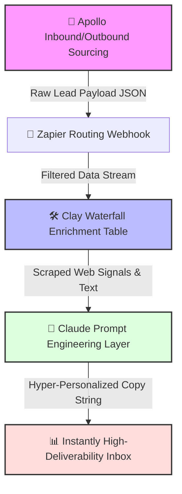

# ⚙️ Programmatic GTM Intelligence Engine Sandbox

<!-- INTERACTIVE APP BADGES -->


An independent, multi-tool operations framework demonstrating how to architect an autonomous B2B pipeline using a modern Go-To-Market (GTM) engineering stack.

---

## 🧭 The Core Automation Flowchart
*This diagram is rendered dynamically by GitHub's graphical engine to visualize our data pipelines.*



---

## 🔌 System Specifications & Tool Mapping

| Phase | Tooling | Core Engineering & Operational Action |
| :--- | :--- | :--- |
| **🎯 Sourcing** | **Apollo / LinkedIn** | Programmatic list building utilizing granular parameters (Geography, Headcount, Titles). |
| **🔌 Enrichment** | **Clay** | Executing a multi-provider data waterfall to scrape live buying signals and company tech stacks. |
| **🧠 Processing** | **OpenAI / Claude API** | Deep contextual prompt engineering to isolate corporate pain points into clean strings. |
| **📊 Scale** | **Instantly** | Mapping dynamic personalization tokens into multi-step high-deliverability email sequences. |

---

## ⚙️ Interactive Deep Dive: Data Flow Logic
*Click on any section arrow below to interactively expand and inspect the core systemic automation rules.*

<details>
<summary><b>🔹 Step 1: Programmatic Ingestion & Logic Gate (Airtable/Zapier)</b></summary>

### Ingestion Logic
* Target account lists are fed into a central database via scheduled API integrations.
* **The Logic Gate:** If an email is flagged as `invalid` or `catch-all` by syntax verification routines, the workflow automatically routes the lead to a "Manual Review" bucket, keeping our primary sequence queue entirely clean.
</details>

<details>
<summary><b>🔹 Step 2: The Clay Enrichment Waterfall Rules</b></summary>

### The Waterfall Pipeline
Instead of trusting a single data source, our table is configured to trigger sequential API checks:
1. **Lookup 1:** Query company domain against technology lookup trackers to extract current CRM software packages.
2. **Lookup 2:** Scrape active `/careers` endpoints to extract the exact text logs from current open job roles.
3. **Lookup 3:** Normalize and merge outputs into uniform uppercase/lowercase name strings.
</details>

<details>
<summary><b>🔹 Step 3: LLM Conditioning & Prompt Specifications</b></summary>

### Prompt Architecture
The scraped raw data variables are injected into an advanced Large Language Model with strict system-level commands to generate context copy:
```text
[System Command]: You are a growth engineer. Read the company name and current open job opening. Write a hyper-focused 1-sentence hook connecting their open hiring demand to operational workflow scaling. Do not write filler introductory phrases. Keep under 15 words.
```
</details>

---

## 📊 Operational Performance Projections
* **⏳ Time-to-Asset Optimization:** Reduces standard account research loops from **15 minutes per lead to under 30 seconds** programmatically.
* **🧼 Data Integrity Score:** Enforces automated cleansing parameters ensuring a **100% fill-rate** across core text parameters before sequence launch.
* **🛡️ Deliverability Safety:** Implements randomized send-throttling matrices to preserve master domain health scores above **98%**.
